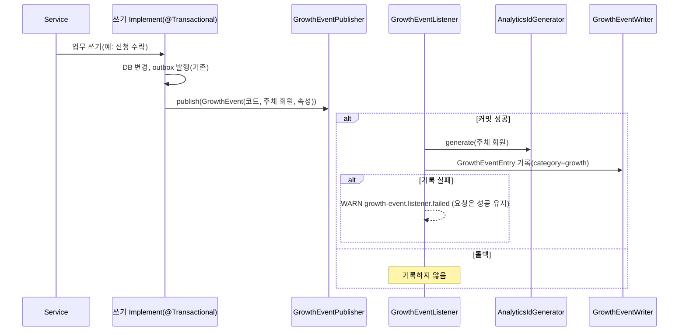

# MOI-521 변경 설명 (PR 3): 그로스 사건 16개 기록

## 배경

그로스 분석(PostHog)에서 보려는 퍼널(가입 → 신청·생성 → 수락 → 확정 → 완료·출석 → 후기 → 재참여)의 서버 쪽 단계는
DB에 확정되는 사건이다(D3). PR 1이 로그 계약(`GrowthEventWriter`)을, PR 2가 가명 회원 식별자(`analyticsId`)를 준비했다.
이 PR은 실제 업무 흐름에서 사건을 남긴다.

## 처리 흐름

- 커밋 후 같은 스레드에서 기록한다. 트랜잭션 밖 발행(후기 건너뛰기)은 저장이 이미 커밋된 뒤라 바로 기록한다.
- outbox는 쓰지 않는다. 사건 절반에만 outbox가 있고, 재전달 시 중복이 생긴다.

## 사건

| 사건 | 주체 | 속성 |
| --- | --- | --- |
| `member.signed_up` / `withdrew` / `restored` | 그 회원 | provider / — / — |
| `resume.registered` | 소유 회원 | resumeId, activeResumeCount |
| `room.created` | 방장 | roomId, jobPostingId, jobRoleId, interviewStage, min/maxParticipants, daysUntilStart |
| `room.confirmed` | 방장 | roomId, participantCount, hoursSinceCreated, reconfirmed |
| `room.completed` | 방장(자동 완료는 현재 방장) | roomId, completedBy(HOST/SYSTEM), confirmedCount, attendedCount |
| `room.canceled` | 방장 | roomId |
| `room.recruiting_reopened` | 재개 시점 방장 | roomId, reason(PARTICIPANT_LEFT/HOST_LEFT) |
| `room_participant.left` | 나간 회원 | roomId, role, roomStatus, byWithdrawal |
| `room_application.submitted` / `withdrawn` / `accepted` / `rejected` | 신청자 | roomId, applicationId (+ minutesSinceSubmitted / rejectReason) |
| `review.submitted` / `review.skipped` | 작성자 | roomId, reviewId, anonymous / roomId |

남기지 않는 경우: 룸 생성 중복 반환, 완료 재전송, 탈퇴·복구 멱등 반환, 슬롯 초과로 끝난 수락, 이미 있는 건너뛰기,
탈퇴 시 대기 신청 일괄 철회, 방장 이탈 시 대기 신청자 승격.

## 바뀌는 것

| | 전 | 후 |
| --- | --- | --- |
| 업무 쓰기 | 변경 없음 | 커밋 후 로그 한 줄(INFO, category=growth) 추가 |
| 실패 영향 | | 기록 실패는 WARN만, 업무 요청은 성공 |
| `ReviewSkipRecorder` | 트랜잭션 없음 | 그대로(중복 충돌을 삼키므로 트랜잭션을 두면 커밋이 깨진다) |

## 제한

- 현재 라우터(v2)는 `eventId`·`analyticsId`·`properties`를 버린다. S3 growth에는 사건 이름만 남는다(PR 4에서 연다).
- `analyticsId`는 키 주입(PR 4) 전까지 null이다.
- 커밋 직후 프로세스가 죽으면 사건이 빠질 수 있다. 정확한 건수는 DB와 대조한다.
- dev QA API의 자동 완료도 `room.completed`(SYSTEM)를 남긴다. `environment`로 걸러진다(D17).

## 검증

- `./gradlew test ktlintCheck` 전체 통과(core-api 1117개).
- 리스너 단위 3개, 커밋·롤백·트랜잭션 밖 IT 3개, Manager별 발행·미발행 단위·IT 테스트.
- 컨벤션 리뷰 필수 1건(탈퇴 사건의 잘못된 나간 룸 수) 반영, 권장 다수 반영.
- 처음 전체 테스트가 테스트 JVM 메모리 부족으로 멈췄다. 별도 Spring 컨텍스트를 만들던 IT를 공용 컨텍스트로 바꿔 해결했다.

## 관련 문서

- 결정: `.worklog/MOI-521-growth-logging/decisions.md` (D3, I18~I23)
- 컨벤션: `docs/conventions/modules.md` "core-api: 그로스 사건"
- Wiki: [로깅 가이드 서버 사건표](https://wiki.agent.plady.io/topics/t-moimyeon-로깅-아키텍처와-사용-가이드/), [그로스 로깅 결정 요약](https://wiki.agent.plady.io/sources/s-moimyeon-growth-logging-decisions/)
