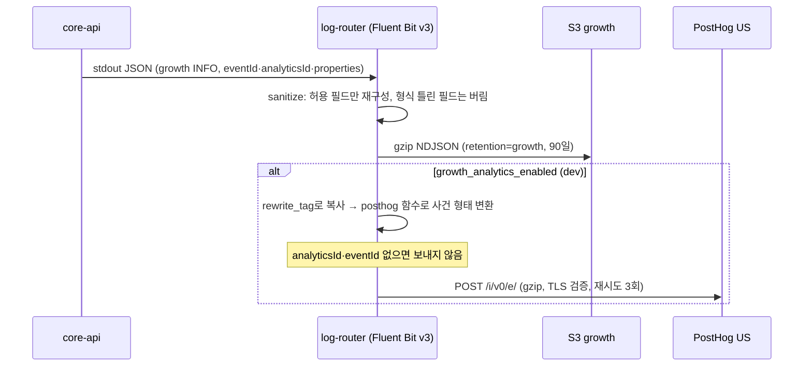

# MOI-521 변경 설명 (PR 4): 그로스 사건을 S3에 온전히 남기고 dev는 PostHog로 보낸다

## 배경

PR 3까지 core-api는 커밋된 업무 사건 16개를 그로스 사건(INFO, `category=growth`)으로 stdout에 남긴다.
하지만 지금 라우터(v2)는 `eventId`·`analyticsId`·`properties`를 버린다. 그리고 `analyticsId`를 만드는 키가 주입되지 않아 값이 비어 있다.
이 PR은 인프라만 바꾼다.

- core-api에 `ANALYTICS_ID_HMAC_KEY`를 SSM에서 주입한다(켠 환경만).
- 라우터 v3가 그로스 필드를 형식 검사 후 S3 growth에 남긴다(모든 환경).
- 켠 환경(dev)의 api 라우터는 그로스 사건 복사본을 PostHog US로 보낸다.

## 처리 흐름

## 바뀌는 것

| | 전 | 후 |
| --- | --- | --- |
| S3 growth | 사건 이름·시각만 | + `eventId`, `analyticsId`, `properties`(형식 검사) |
| core-api `analyticsId` | 항상 null | dev: 값 있음 / live: null 유지 |
| PostHog | 서버 사건 없음 | dev만 서버 사건 16개 수신(`environment=dev`) |
| 라우터 설정 | v2 | v3 (v1·v2 객체는 롤백용으로 유지) |
| IAM | | dev api 실행 역할이 SSM 2개(HMAC 키, PostHog 토큰)를 더 읽음. CI plan 역할은 두 값 읽기 거부 |

`growth_analytics_enabled`: dev `true`, live `false`(처리방침 법률 검토 후 켠다, D10).

## 검증

- `terraform fmt -check`, `validate`(1.15.9), 모듈 test: application-logging 6개, moimyeon-environment 10개.
- Docker smoke(운영과 같은 Fluent Bit digest): growth 필드 거름, 16개 상한, PostHog 대역으로 간 gzip 사건 형태, analyticsId 없는 사건 미전송, 토큰 외 비밀 미노출. 라우터 메모리 51MiB/128MiB.
- 계약 스크립트 15개, deploy 입력 테스트 24개, `./gradlew test ktlintCheck`.

## 제한

- PostHog 출력은 디스크 버퍼가 없다. PostHog 장애가 길면 사건이 빠지고, S3 growth와 DB 대조로 센다.
- `properties` 숫자는 Fluent Bit Lua를 거치며 실수로 바뀔 수 있다(3 → 3.0). 분석에는 영향 없다.
- 실제 PostHog 수신은 dev 배포 후 확인한다(9단계).

## 관련 문서

- 결정: `.worklog/MOI-521-growth-logging/decisions.md` (D10, D12, D14, D17, I24~I28)
- 모듈 설명: `infra/terraform/modules/application-logging/README.md` "PostHog 전송 (v3)"
