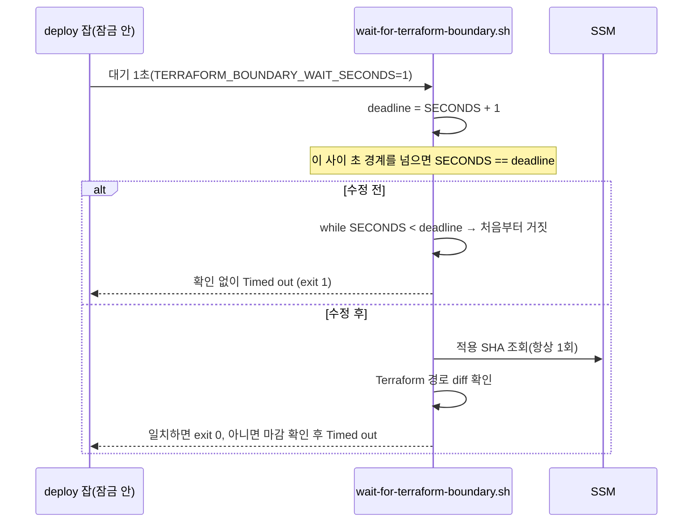

# 변경 설명: Terraform 경계 확인이 최소 한 번은 검사하게 수정

## 배경

2026-10-11 dev 배포가 배포 잠금 안의 Terraform 경계 확인에서 `Timed out waiting for Terraform Apply`로 실패했다.
적용 SHA는 이미 배포 커밋을 덮고 있었고(같은 실행의 prepare 단계가 통과), 실패 단계는 8ms 만에 아무것도 확인하지 않고 끝났다.
재실행으로 복구했다.

## 원인과 수정

반복문을 "확인 → 마감 비교 → 대기" 순서로 바꿨다. 대기 예산이 길 때(prepare 단계 기본 5400초)의 동작은 같다.

## 바뀌는 것

| | 전 | 후 |
| --- | --- | --- |
| 잠금 안 1초 확인 | 초 경계에 걸리면 확인 없이 실패 | 항상 한 번 확인 |
| 적용되지 않은 Terraform 변경 | 기다림·마감 후 실패 | 같음 |

## 검증

- 계약 테스트에 DEBUG trap으로 매 명령마다 `SECONDS`를 올리는 시계를 넣어 경계를 결정적으로 재현했다.
  수정 전 스크립트는 "마감이 지나도 첫 확인은 해야 한다"로 실패, 수정 후 통과.
- `deploy-workflow-contract.sh` 통과.

## 배포 영향

`infra/terraform/scripts`가 Terraform 경로 범위라 머지 후 Terraform Apply가 한 번 돈다. 자원 변경은 없다. live 영향 없음(dev 배포 경로의 스크립트).
